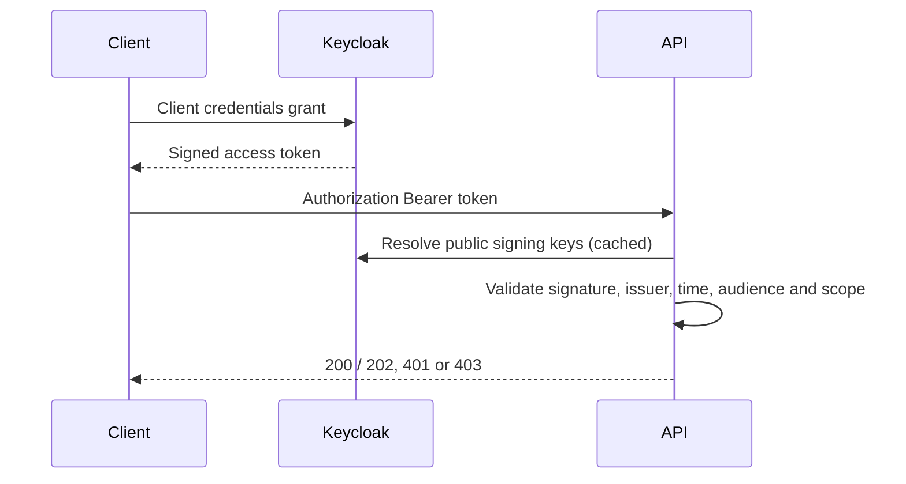

# OAuth 2.0, JWT and Spring Security

[](https://github.com/mohsin-shabbir/spring-security-oauth2-jwt/actions)

A stateless OAuth 2.0 resource server for a synthetic collections API. Uses Spring Security's built-in JWT verification with RS256, issuer, audience, expiry and scope checks. Independent portfolio example created with AI assistance.

## Flow


## Run and obtain a token
Java 17+, Maven 3.6.3+; Docker Compose for the optional local identity server.
```sh
mvn verify
export DEMO_ADMIN_PASSWORD="$(openssl rand -hex 24)"
export DEMO_CLIENT_SECRET="$(openssl rand -hex 24)"
docker compose up -d
mvn spring-boot:run
```
Keep the variables in the terminal used for token requests. Local demo identity data is ephemeral; after changing credentials recreate the container.
```sh
TOKEN=$(curl -fsS http://localhost:8081/realms/portfolio/protocol/openid-connect/token \
  -d grant_type=client_credentials -d client_id=portfolio-service \
  --data-urlencode "client_secret=$DEMO_CLIENT_SECRET" \
  --data-urlencode "scope=collections.read collections.write" | jq -r .access_token)
curl -i http://localhost:8082/api/collections -H "Authorization: Bearer $TOKEN"
curl -i http://localhost:8082/api/collections -H "Authorization: Bearer $TOKEN" \
  -H "Content-Type: application/json" -d '{"agreementId":"DEMO-001","amountMinor":12500}'
```
Omit the write scope to demonstrate a 403 on POST. Missing, forged, expired, wrong-issuer and wrong-audience tokens return 401. The tests use real RSA signatures and the HTTP security filter chain, without a live identity provider. Stop with `docker compose down`.

## Security decisions
- OAuth 2.0 is the authorization protocol; JWT is the access-token format.
- The API validates tokens; it does not invent a password-to-JWT login endpoint.
- Default deny, narrow HTTP-method scopes, stateless sessions, no cookie authentication.
- CSRF disabled for bearer-header API only. Reconsider for browser cookie/session designs.
- Client credentials is for confidential machine clients. User-facing mobile/web login should use authorization code + PKCE; that flow is not implemented here.
- Keycloak development mode and HTTP are loopback-only local conveniences. Production requires HTTPS, proper identity-server operations, key rotation, managed secrets, rate limits and audit controls.
- Read data is synthetic; POST validates and acknowledges a demo request without persistence.
- The Keycloak Compose flow is a manual integration path; automated tests exercise the API decoder and authorization behavior.

[Spring Security JWT reference](https://docs.spring.io/spring-security/reference/servlet/oauth2/resource-server/jwt.html)

